  

 

## The short version

I'm **Srikant Hamsa** — I build things, then open-source them, because good software should outlive the mood that produced it. My centre of gravity is **UI/UX**: native-feeling interfaces, deliberate motion, and details that survive the second glance. I ship across **macOS, iOS, Windows and Android**, and I port games to the Mac for sport.

> Anything that feels wrong in the hand isn't finished.

## What I ship

|  |  |  |
| :-- | :-- | :-- |
| **Cross-platform apps**  One idea, four native personalities. The same product, rethought per platform — right gestures on iOS, right keyboard on Windows, right menu bar on macOS. | **Game ports to macOS**  Apple Silicon native, retina-crisp, controller-first. Ports that behave like the platform they moved to, instead of guests stuck in a wrapper. | **Mods & tooling**  The fixes and utilities communities actually ask for — patches, mods and small sharp tools, built in the open and maintained like they're mine. |

## Tools of the trade

 

## By the numbers

<table>
  <tr>
    <td></td>
    <td></td>
  </tr>
</table>

  

## The long game

<picture>
  <source media="(prefers-color-scheme: dark)" srcset="https://raw.githubusercontent.com/srikanthamsa/srikanthamsa/output/snake-dark.svg" />
  <source media="(prefers-color-scheme: light)" srcset="https://raw.githubusercontent.com/srikanthamsa/srikanthamsa/output/snake.svg" />
  
</picture>

_The snake eats the squares. The commits keep coming._

## Currently

<!-- Keep these three lines honest — they're the most-read part of this page. -->

- **Building** — a cross-platform app where motion carries meaning, not decoration.
- **Porting** — a game I refuse to stop playing, to Apple Silicon. Profiling frames, not vibes.
- **Learning** — Metal, shaders, and the last 5% of feel that eats 80% of the time.
- **Open to** — collaborations on open-source apps, macOS ports, and interface craft.

## Say hello

Everything I'm proud of lives here, in the open. If you're building in the open too — or you know a game that deserves a better life on the Mac — my inbox is open.

 

  

